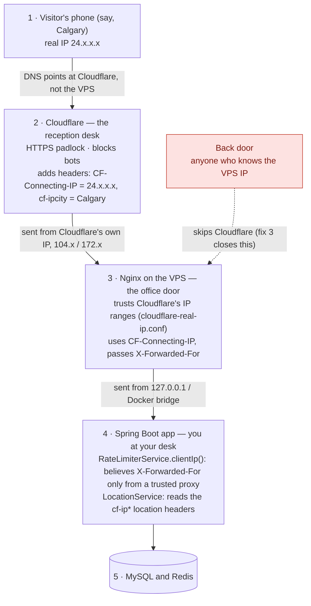

# How a request reaches RapidStylers: Cloudflare, Nginx and the app

_Written October 10, 2026, for someone learning the stack. The target design is in [`target-architecture.md`](./target-architecture.md)._

## The mental picture

Think of an office building.

- **Cloudflare is the reception desk.** Your domain points at reception, not at your office, so every visitor checks in there first. Reception shows the HTTPS padlock, turns away bots, and staples a note to each visitor saying who they are and where they're from.
- **Nginx is your office door.** It only believes reception's note because it can see the note was handed over by reception (Cloudflare's own IP address).
- **The Spring Boot app is you at your desk.** You read the note that Nginx passed in and get on with the work.

## Step by step

| Step | Who | What happens | Where in the repo |
|---|---|---|---|
| 1 | Visitor | Their browser asks DNS for `rapidstylers.ca` and gets a Cloudflare address, not the VPS. Their real IP is, say, `24.x.x.x`. | `deploy/cloudflare/DNS-records.md` |
| 2 | Cloudflare | Terminates HTTPS, filters bots and attacks, adds `CF-Connecting-IP: 24.x.x.x` and the visitor-location headers (`cf-ipcity`, `cf-ipcountry`, `cf-iplatitude`, …), then forwards the request from its own IP (`104.x`, `172.x`, …). | Dashboard: SSL/TLS = Full (strict); Rules › Settings › Managed Transforms › "Add visitor location headers" = on |
| 3 | Nginx | A second HTTPS hop using the Cloudflare origin certificate. Because the request comes from a Cloudflare range, Nginx trusts `CF-Connecting-IP` and treats `24.x.x.x` as the client. It passes the request to the app with `X-Forwarded-For` and `X-Real-IP`. | `deploy/nginx/cloudflare-real-ip.conf`, `deploy/nginx/sites-available/api.YOURDOMAIN.com.conf` |
| 4 | App | `RateLimiterService.clientIp()` reads `X-Forwarded-For` only when the request came from a trusted proxy (Nginx). `LocationService` reads the `cf-ip*` headers to know the visitor's city and coordinates. | `service/RateLimiterService.java` (`clientIp`, line 139), `service/LocationService.java` |
| 5 | Data | Rate-limit counters in Redis are keyed by that visitor IP; bookings and accounts live in MySQL. | |

## The one rule to remember

**A header is just text, and anyone can write one.** A visitor can send `X-Forwarded-For: 1.2.3.4` themselves. You only believe a header like that when it was handed to you by someone you trust: Nginx trusts Cloudflare, and the app trusts Nginx.

## The three edge fixes

1. **Read the location from Cloudflare (done, October 10).** `LocationService` used to call ip-api.com, which always fell back to Edmonton. It now reads Cloudflare's location headers.
2. **The app trusts only Nginx.** `RATE_LIMIT_TRUSTED_PROXIES` in `docker-compose.prod.yml` lists Nginx (`127.0.0.1`, the Docker bridge) and every Cloudflare range. The app never talks to Cloudflare directly, and Nginx already checked those ranges, so the app's copy is a second list to keep in sync. The fix trims it to Nginx only.
3. **Lock the back door.** Anyone who finds the VPS IP can skip Cloudflare and talk to Nginx directly. The fix is on the VPS, not in code: a firewall rule that only accepts ports 80 and 443 from Cloudflare's ranges, or Cloudflare's Authenticated Origin Pulls.
