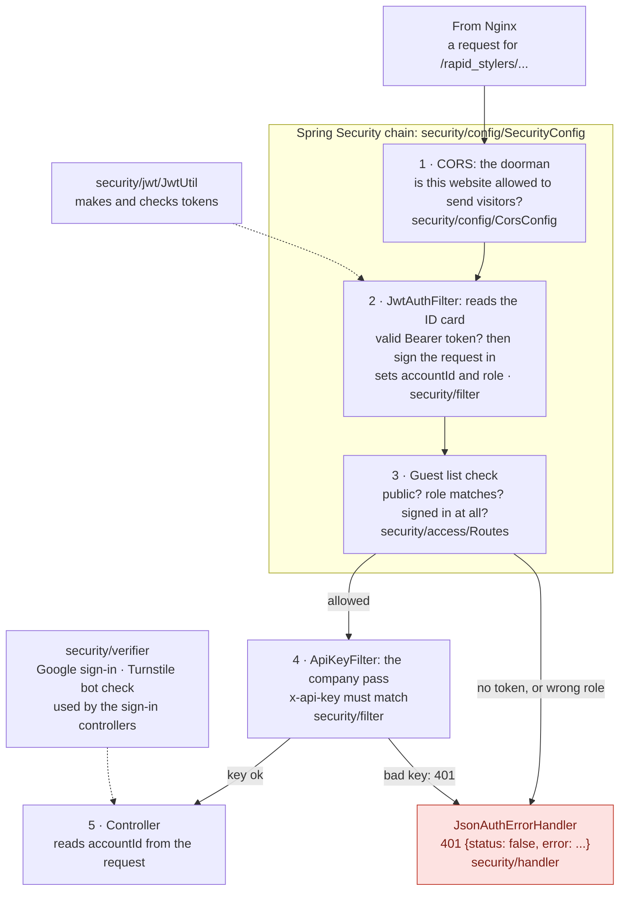

# How the app decides who may do what: Spring Security

_Written October 10, 2026, for someone learning the stack. [`cloudflare.md`](./cloudflare.md) covers how a request gets to the app; this page starts where that one stops. The target design is in [`target-architecture.md`](./target-architecture.md)._

## The mental picture

In [`cloudflare.md`](./cloudflare.md), Cloudflare is the reception desk and Nginx is the office door. Now walk inside: the app has its own security desk in front of every room (every controller route).

- **CORS is the doorman.** A browser asks first: "may a page from `rapidstylers.ca` talk to you?" The doorman checks the list of allowed websites.
- **The JWT is the visitor's ID card.** After sign-in the app hands out a signed card that says "account `C123`, role `CUSTOMER`". `JwtAuthFilter` reads the card on every request. It never turns anyone away; it only works out who they are.
- **`Routes` is the guest list on the clipboard.** It says which rooms anyone may enter (sign-in, the catalog) and which rooms need a card with a given role (admin, stylist, customer).
- **Closed by default.** A room that is not on the list at all still opens, but only for someone holding a valid card. Forgetting to list a new room keeps strangers out instead of letting everyone in.
- **`JsonAuthErrorHandler` is the polite "sorry, no entry" note**: a 401 with a small JSON body.
- **The `x-api-key` is the company pass.** The frontend app carries a shared key. `ApiKeyFilter` checks it after the guest list.

## The folder

Everything about "who are you and may you come in" lives in `src/main/java/com/macrotel/rapidstylers/security/`. Each subfolder has one job.

| Folder | Class | Its one job |
|---|---|---|
| `config/` | `SecurityConfig` | Wires the chain together: CORS, the JWT filter, the rules from `Routes`, the 401 handler, the security headers. Also provides the BCrypt `PasswordEncoder`. |
| `config/` | `CorsConfig` | Which websites may call the API from a browser. |
| `access/` | `Routes` | The guest list. Data only: public routes and the routes for each role. |
| `filter/` | `JwtAuthFilter` | Reads the `Authorization: Bearer` token and signs the request in. Sets the `accountId` and `role` request attributes the controllers read. |
| `filter/` | `ApiKeyFilter` | Checks the shared `x-api-key`. |
| `handler/` | `JsonAuthErrorHandler` | Writes the 401 JSON for "no token" and "wrong role". |
| `jwt/` | `JwtUtil` | Makes and checks the signed tokens. |
| `verifier/` | `GoogleTokenVerifier`, `TurnstileVerifier` | Ask Google ("is this Google sign-in real?") and Cloudflare Turnstile ("is this a human?"). |

Tests mirror the same folders under `src/test/java/.../security/`.

## One request, step by step

Take a stylist opening their reviews page: `GET /rapid_stylers/styler/reviews` with a stylist's token.

| Step | Who | What happens |
|---|---|---|
| 1 | CORS | The `Origin` is `https://rapidstylers.ca`, which is allowed, so the response will carry `Access-Control-Allow-Origin`. |
| 2 | `JwtAuthFilter` | The token is valid: account `S42`, role `STYLER`. It records the stylist as signed in and sets `accountId = S42`. It also notes the activity in Redis for the idle timeout (except on `/auth/refresh`). |
| 3 | Rules from `Routes` | `/styler/reviews` is in `Routes.STYLER` and the card says `STYLER`, so the request goes on. A customer's card would get a 401 here. |
| 4 | `ApiKeyFilter` | The `x-api-key` matches, so the request reaches the controller. |
| 5 | Controller | Reads `accountId` and returns S42's reviews. |

## How to add a route

1. Write the controller method as usual.
2. Decide who may call it, and add one line to the right list in `security/access/Routes.java`:
   - anyone: `PUBLIC`
   - one role: `ADMIN`, `STYLER` or `CUSTOMER`
   - image uploads (stylist, admin, or a stylist still signing up): `UPLOAD`
   - any signed-in account: add nothing (closed by default does it).
3. Run the tests. `RoutesTest` fails if a listed route has no controller (a typo), if a route is in two lists, or if a public route reads `accountId` (it would always be `null` there). `SecurityRulesTest` checks the real chain without a database; add a row to its table for the new route.

Nothing else changes. That is the point of keeping the rules as data in one place.

## The principles behind the layout

- **Single responsibility.** Each class has one reason to change. New route: `Routes`. New allowed website: `CorsConfig`. Different error body: `JsonAuthErrorHandler`. The filter that reads tokens doesn't also decide who may enter, which is how the old `ROLE_PATHS` map caused the `/styler/reviews` bug.
- **Open for extension, closed for modification.** Adding a route is a data change in `Routes`; `SecurityConfig` doesn't need editing.
- **Fail safe.** Closed by default means a mistake gives a 401, not an open door.
- **Use the framework's own pieces.** The rules are standard Spring Security (`authorizeRequests`, `AuthenticationEntryPoint`, `AccessDeniedHandler`), so anyone who knows Spring can read them, and the Spring Boot 3 upgrade is a rename rather than a rewrite.
- **No interfaces for their own sake.** Each job has exactly one implementation, so there are no extra interfaces to read through (you aren't going to need them). Add one only when a second implementation appears.

## Why `mvcMatchers` and not `antMatchers`

Spring MVC treats `/user_data` and `/user_data/` as the same route. A plain `antMatchers("/user_data")` rule would not match the trailing-slash version, so that request would skip the `CUSTOMER` rule and fall through to "any signed-in account". `mvcMatchers` matches paths exactly the way the controllers do, so the variant gets the same rule. `SecurityRulesTest` has a row for this.

## What changed on October 10, 2026

| Before | After |
|---|---|
| `anyRequest().permitAll()`: Spring Security let everything through | `anyRequest().hasAnyRole(Roles.ACCOUNTS)` with explicit public and role lists |
| `JwtAuthFilter` read tokens **and** enforced a hand-kept `ROLE_PATHS` map; it set `accountId` only for listed paths | `JwtAuthFilter` only reads tokens; `SecurityConfig` enforces the rules in `Routes` |
| A route missing from the map was public and always answered 401 to signed-in users (`/styler/reviews`, `/auth/logout`) | A route missing from the lists needs any signed-in account and works for everyone signed in |
| CORS ran three times; `JwtAuthFilter` was registered twice | Each runs once |
| Security classes spread across `config/` and `security/`; the API-key filter was called `AppConfig` | One `security/` folder with a subfolder per job; `ApiKeyFilter` says what it is |

Every existing route keeps its access and the same 401 body. The one visible difference: a path that doesn't exist now answers 401 instead of 404 to callers without a token, because the guest list is checked before the app looks for the room.

## Left for later

- **`/testing` is public.** It returns a fixed text and touches no data. Confirm nothing needs it; if not, delete it.
- **A revoked session keeps working for up to 15 minutes.** Signing out, a password change or disabling an admin burns the refresh tokens at once, but an access token already handed out stays valid until it expires (15 minutes). Closing that gap needs a server-side deny list; not worth it yet.
- **Account ids are unique by checking before insert, not by the database.** Add a unique constraint once production is checked for existing duplicates.
- **The booking's travel distance comes from the browser**, so the travel fee can be under-charged. That is a pricing fix for the bookings domain.
- **No per-email cap on wrong OTP guesses** (there is a per-IP limit).
- **Controllers read `accountId` from a request attribute.** The target is to read the signed-in account from Spring's principal; that happens when the controllers are split by domain.
- **Spring Boot 3 renames:** `authorizeRequests` becomes `authorizeHttpRequests`, `mvcMatchers` and `antMatchers` become `requestMatchers`, `@EnableGlobalMethodSecurity` becomes `@EnableMethodSecurity`, and `javax.servlet` becomes `jakarta.servlet`.

## The security pass on October 10, 2026 (step 2)

| Hole | Fix |
|---|---|
| `/user_sign_in` skipped the Turnstile bot check | Deleted; customers sign in through `/sign_in` |
| `/get_upload_signature` was public, so anyone could upload to our Cloudinary | Moved to `Routes.UPLOAD`: `STYLER`, `ADMIN` or the sign-up pass |
| Any stylist could delete any image through `/delete_cloudinary_image` | It deletes only images no profile, portfolio, service or blog post uses, and only ids under `rapid_stylers/` |
| The "is this image still used?" check could be fooled by a differently spelled URL | It matches on the image's public id |
| The `ADMIN_PASSWORD` from `.env` also worked on `/sign_in`, even after the admin changed or was disabled | Removed; admins sign in only through `/admin_sign_in` (the admin login page) |
| Resetting or changing a password left other devices signed in | Both sign out every other device; a password change hands this device a fresh token pair |
| A disabled admin, or one whose password changed, could keep refreshing | Their refresh tokens are burned |
| A short customer or stylist id could clash with an existing one | New ids are checked against both tables and redrawn |
| Google sign-in on a deactivated account created a second account | It is refused |
| Swagger and `/v3/api-docs` were public in production | Off unless `API_DOCS_ENABLED=true` (set it in your local `.env`) |
| `ApiKeyFilter` exempted `/rapid_stylers/files/`, which no controller serves | Exemption removed |

## The sign-up upload pass

A new stylist uploads their profile and ID photos before their account exists, so they have no sign-in token. Verifying their email code (`/styler_verify_otp`) hands out a pass instead: a token whose subject is the email and whose role is `SIGNUP_UPLOAD`, valid for two hours.

Picture a visitor badge printed at reception. It gets you to one room (`Routes.UPLOAD`: the upload signature and deleting an unused image) and nowhere else: unlisted routes need a real account role (`Roles.ACCOUNTS`), so the badge cannot reach them, and `JwtAuthFilter` gives it no `accountId` and no session activity, because it is not an account.
