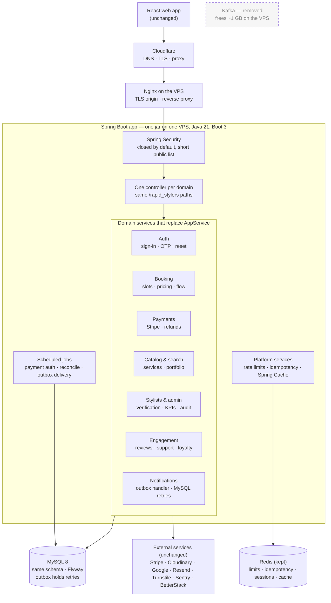

# RapidStylers backend: target architecture

_Adopted October 10, 2026._

_This is the architecture every refactor PR moves toward. This file describes where the system ends up; [`cloudflare.md`](./cloudflare.md) explains the edge as it runs today. The full plan, with bugs, line references and decisions, is the "RapidStylers backend simplification plan" doc: https://claude.ai/code/artifact/6042df98-2c80-4b42-925d-6dbce3ea8c27_

The outside of the system doesn't change: the same three hops, the same URLs, the same database. The inside goes from one service to seven, each with its own tests. Notifications are delivered from the MySQL outbox instead of a round trip through Kafka.

## Diagram



Plain-text version:

```
  React web app ──────▶ Cloudflare ──────────▶ Nginx on the VPS
  (unchanged)           DNS, TLS, proxy         TLS origin, reverse proxy
                                                        │
 ┌──────────────────────────────────────────────────────▼──────────────────┐
 │ Spring Boot app: one jar on one VPS, Java 21, Boot 3                    │
 │                                                                         │
 │  Spring Security                    ──▶  One controller per domain      │
 │  closed by default, short public list    same /rapid_stylers paths      │
 │                                                  │                      │
 │  ┌─ Domain services that replace AppService ─────▼────────────────────┐ │
 │  │  Auth            Booking           Payments        Catalog, search │ │
 │  │  sign-in, OTP,   slots, pricing,   Stripe,         services,       │ │
 │  │  reset           flow              refunds         portfolio       │ │
 │  │                                                                    │ │
 │  │  Stylists and admin     Engagement            Notifications        │ │
 │  │  verification, KPIs,    reviews, support,     outbox handler,      │ │
 │  │  audit                  loyalty               MySQL retries        │ │
 │  └────────────────────────────────────────────────────────────────────┘ │
 │                                                                         │
 │  Platform services                       Scheduled jobs                 │
 │  rate limits, idempotency, Spring Cache  payment auth, reconcile,       │
 │                                          outbox delivery                │
 └───────┬──────────────────────────────┬──────────────────────────────────┘
         │                              │
  ┌──────▼──────────────┐   ┌───────────▼─────────┐   ┌ ─ ─ ─ ─ ─ ─ ─ ─ ─ ┐
  │ MySQL 8             │   │ Redis (kept)        │     Kafka: removed
  │ same schema, Flyway │   │ limits, idempotency,│   │ frees ~1 GB on VPS │
  │ outbox holds retries│   │ sessions, cache     │
  └─────────────────────┘   └─────────────────────┘   └ ─ ─ ─ ─ ─ ─ ─ ─ ─ ┘

  External services (unchanged): Stripe, Cloudinary, Google, Resend,
  Turnstile, Sentry, BetterStack
```

## What changes, and what doesn't

| Area | Today | Target |
|---|---|---|
| Edge | Cloudflare → Nginx → app; location from ip-api.com; Cloudflare IPs kept in two lists | Same hops. Location from Cloudflare's visitor-location headers. App trusts only Nginx; origin accepts only Cloudflare |
| Security | `anyRequest().permitAll()` + hand-kept `ROLE_PATHS` map + `accountId` request attribute | Standard Spring Security: `anyRequest().authenticated()` with a short `permitAll()` list, so a forgotten path fails closed. Controllers read the principal. `x-api-key` stays for now |
| Controllers | `ApplicationController`, 1,288 lines, 117 routes | One controller per domain, same paths and `BaseResponse` shape |
| Services | `AppService`, 5,534 lines, 46 dependencies | Seven domain services (below); no class over 800 lines |
| Events | Outbox → Kafka (3 topics) → `NotificationEventConsumer` | Outbox → `OutboxPublisherJob` calls the notification handler in-process; `attempts`, `next_attempt_at` and `status=FAILED` replace the retry and DLQ topics |
| Redis | 7 uses, custom `ReadCacheService` | Kept; read cache becomes Spring `@Cacheable(sync = true)` |
| Database | MySQL 8, Flyway V1 to V15 | Unchanged schema; no destructive migrations |
| Framework | Spring Boot 2.7, Java 17, `javax.*` | Spring Boot 3, Java 21, `jakarta.*` (last step) |

## Domain services

| Service | Takes over from `AppService` | Simplification |
|---|---|---|
| `AuthService` | `signIn`, `signInWithGoogle`, sign-up and OTP flows, password reset, logout | Delete `/user_sign_in` and `/styler_sign_in`; merge customer and stylist OTP flows |
| `PaymentService` | Stripe webhook, payment authorizations, retries, refunds, cards, Connect payouts, commission | Folds `StripeService`, `PaymentOpsService` and `PaymentReconciliationService` behind one service |
| `BookingService` | `estimateBooking`, `bookAppointment`, `transitionAppointment`, availability, travel settings | Calls `PaymentService`, not Stripe; pricing becomes a `TravelPricing` class in cents |
| `CatalogService` | Services, portfolio, blog, `searchNearby`, `searchStyler*`, stylist details | One search with filters; old URLs kept as aliases |
| `StylerService`, `AdminService` | Stylist creation, verification queue, moderation, KPIs, audit, failed events | Matches the existing admin controllers |
| Engagement (`NotificationService`, `ReviewService`, `SupportService`, `LoyaltyService`) | Notifications, reviews, support tickets, loyalty and referrals, saved stylists | Mostly moves |

## Ground rules for getting there

- **The contract is frozen.** All endpoints keep the same URLs, request bodies, `BaseResponse` shape and status codes.
- **The tests are the floor.** `./mvn21 test` stays green after every step, and each new service gets its own tests.
- **One change per branch.** Pure moves first, behaviour fixes in a separate change.
- **No destructive migrations.** Unused columns and tables are dropped one release later, after a backup.
- **Keep a delegating facade until the end.** `AppService` forwards to the new services until the controllers are split.

## Order

1. Edge (done in code October 10; Nginx files still to be installed on the VPS): Cloudflare visitor-location headers, trust only Nginx in `RATE_LIMIT_TRUSTED_PROXIES`, Nginx refuses anything that skipped Cloudflare.
2. Bugs: slot-race card hold, empty idempotent replay, unreleased idempotency claim, legacy sign-in endpoints, `/styler/reviews` 401.
3. Services: security, auth, payments, booking, catalog, stylists and admin, engagement, controllers, then the Spring Boot 3 upgrade.

How the edge works (Cloudflare, Nginx, client IPs): [`cloudflare.md`](./cloudflare.md).
